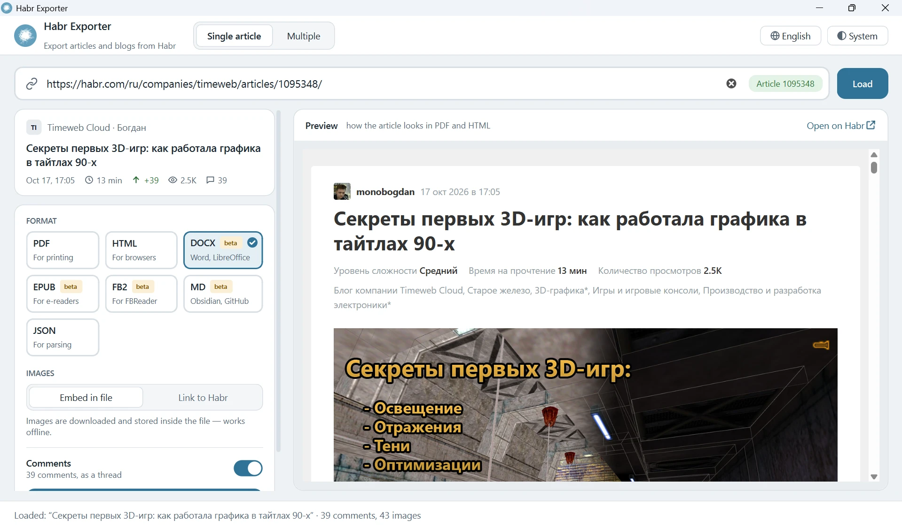
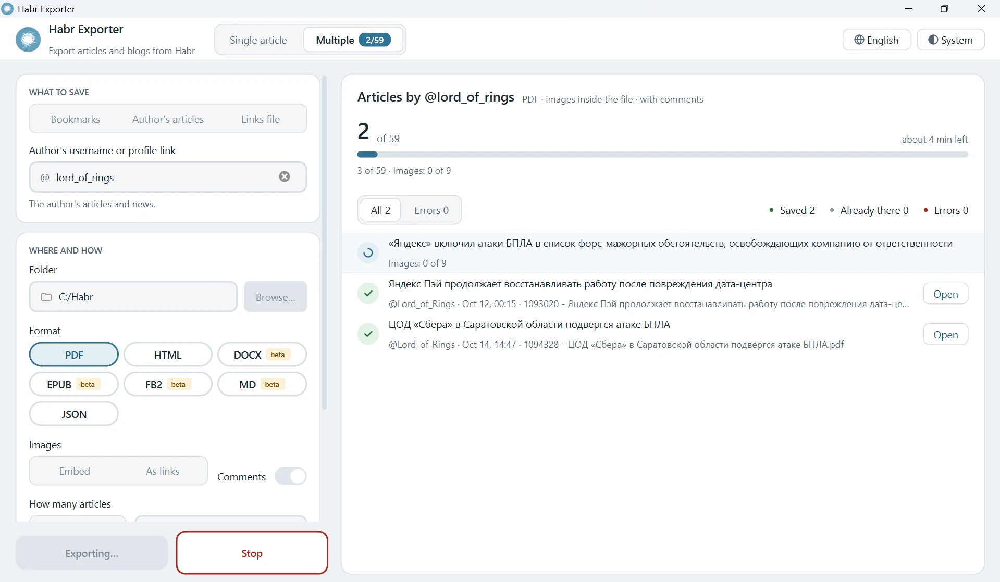
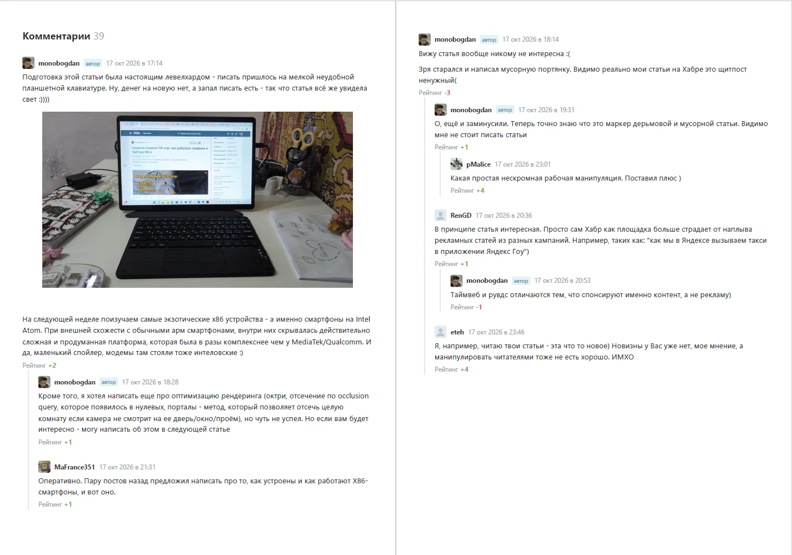

<div align="center">
  <p>
    <a href="#"></a>
  </p>
</div>

# Habr Exporter
<b>Exporting articles and blogs from Habr</b>

[](https://github.com/GVCoder09/HabrExporter)
[](LICENSE)
[](pyproject.toml)
[](https://github.com/GVCoder09/HabrExporter)
[](https://github.com/GVCoder09/HabrExporter)
[](https://github.com/GVCoder09/HabrExporter)
[](https://github.com/GVCoder09/HabrExporter)
[](https://github.com/GVCoder09/HabrExporter)
[](https://github.com/GVCoder09/HabrExporter)
[](https://gvcoder09.github.io/HabrExporter/)

🌐 **[Website & Documentation](https://gvcoder09.github.io/HabrExporter/)** - user-friendly guide and overview

**Read this in other languages / Читайте на других языках**
- **[English](README.md)**
- [Русский](README.ru.md)

<p align="center">
  
</p>

## Table of Content <!-- omit in toc -->
- [Habr Exporter](#habr-exporter)
  - [Description](#description)
    - [Key advantages and features](#key-advantages-and-features)
  - [Quick start](#quick-start)
  - [Installation with pip](#installation-with-pip)
  - [Running](#running)
    - [Working in the window (Single article mode):](#working-in-the-window-single-article-mode)
    - [Batch export](#batch-export)
    - [Command-line mode](#command-line-mode)
  - [How the formats differ](#how-the-formats-differ)
    - [Markdown for notes and wikis](#markdown-for-notes-and-wikis)
    - [JSON for programs](#json-for-programs)
  - [Documentation](#documentation)
  - [Development](#development)
  - [Limitations](#limitations)
  - [Reporting problems](#reporting-problems)
  - [License](#license)
  - [Star History](#star-history)


## Description

**HabrExporter** is a PyQt6 desktop application that saves an article from [Habr](https://habr.com) to your computer as **PDF**, **HTML**, **DOCX**, **EPUB**, **FB2** or **Markdown**, together with its comments, images and in a layout that mirrors the site. For processing by programs there is **JSON**: article and comment data without layout.

<p align="center">
  
</p>

### Key advantages and features

The program operates in two modes: single-item saving (saving an individual post) and batch saving. In the latter mode, you can save an author’s entire blog, another user’s bookmarks, or a list of links imported from a file.

The main formats are PDF, HTML and JSON. DOCX, the EPUB and FB2 e-books, and Markdown are still in beta: their layout may differ from the site.

A saved file contains the article with its markup (headings, lists, tables, spoilers, formulas, code with syntax highlighting, images with captions), the author and company cards, tags, hubs, rating and all comments as a tree, as on the site.

## Quick start

Download the latest version for your OS from [latest release](https://github.com/GVCoder09/HabrExporter/releases/latest), unpack it anywhere and run.
  
## Installation with pip

> [!IMPORTANT]
> Make sure you have Python 3.11+ installed
> 

Run `pip install git+https://github.com/GVCoder09/HabrExporter.git`

This installs two commands: `habr-exporter` (the window) and `habr-exporter-cli` (the command line).

On Linux, Qt WebEngine needs the usual desktop libraries (OpenGL/EGL, NSS, X11/xkb). Any desktop system has them; for a minimal or headless one, see the package list in [.github/workflows/ci.yml](.github/workflows/ci.yml).

**For development**, see [CONTRIBUTING.md](CONTRIBUTING.md).

## Running

The GUI application:

```bash
habr-exporter
```

If the package is not installed as a command, use `python -m habr_exporter`. A link can be passed right away (`habr-exporter https://habr.com/ru/articles/123456/`), and the article starts loading at startup.

### Working in the window (Single article mode):

1. Paste an article link (a bare number works too) and press **Load** (or Enter). A preview and an article card appear.
2. Choose a **format**: PDF (default), HTML, DOCX, EPUB, FB2, MD or JSON.
3. Choose **images**: **Embed in file** (downloaded, the file opens offline) or **Link to Habr** (smaller file).
4. Turn off **Comments** if needed.
5. Press **Save** (Ctrl+S) and choose where to put the file.

The theme (system, light or dark) and the language (Russian or English) are switched by the buttons in the top right corner. The chosen format, image mode, theme and language are remembered between runs.

### Batch export

<p align="center">
  
</p>

The **Batch** tab saves many articles to a folder at once. Sources:

* **Bookmarks**: all public bookmarks of a user (`boomburum`, `@boomburum` or a profile link);
* **Author's articles**: all of their articles and news;
* **Links file**: a text file with one link or article number per line (`#` starts a comment).

Choose a folder, format and image mode, and press **Start**. Progress and a log of saved, skipped
and failed articles are shown on the right; failed ones can be retried, and **Stop** interrupts the
export after the current article.

* The file name starts with the article number: `1094766 - Title.pdf`.
* Articles already in the folder in this format are skipped, so a rerun only downloads new ones
  (an incremental backup).
* A failed article (deleted, hidden, network error) does not stop the export.
* At the end `index.html` appears in the folder, listing all articles sorted by date, newest first.
* **How many articles** limits the export to the latest N; **Delay between requests** (1 second by default, 0 for none) avoids overloading Habr.

### Command-line mode

```bash
habr-exporter-cli https://habr.com/ru/articles/123456/ -f html -i embed -o ./saved/
```

| Option | Meaning |
|---|---|
| `url` | article link or its number |
| `-f`, `--format` | `pdf` (default), `html`, `docx`, `epub`, `fb2`, `md`, `json` |
| `-i`, `--images` | `embed` (default) or `link` |
| `-o`, `--output` | file or folder; defaults to the current folder |
| `--no-comments` | do not save comments |
| `-q`, `--quiet` | do not print progress |
| `-V`, `--version` | print the version and exit |

The path of the saved file goes to stdout, progress and errors go to stderr. Exit code: `0` - saved, `1` - an error.

Batch export: specify a source instead of a link, and a folder in `-o`.

```bash
habr-exporter-cli --bookmarks boomburum -f pdf -o ./bookmarks/
habr-exporter-cli --author boomburum -f html --delay 2 -o ./boomburum/
habr-exporter-cli --from-file links.txt -f docx -o ./saved/
```

| Option | Meaning |
|---|---|
| `--bookmarks USER` | all public bookmarks of a user |
| `--author USER` | all articles and news of an author |
| `--from-file PATH` | links from a text file, one per line |
| `--delay SEC` | delay between requests to Habr, `1` by default |
| `--limit N` | save at most N latest articles |

The `-f`, `-i`, `--no-comments` and `-q` options work as for a single article. Exit code: `0` -
everything saved, `2` - some articles were not saved, `1` - failed to get the list, `130` -
interrupted with Ctrl+C.

## How the formats differ

| | PDF | HTML | DOCX (beta) | EPUB (beta) | FB2 (beta) | Markdown (beta) | JSON |
|---|---|---|---|---|---|---|---|
| Look | A4 pages in Habr layout | exact copy of the Habr layout | Word styles close to Habr | Habr-like; the reader picks font and width | the reader's own styling | the viewer's styling; YAML front matter | no layout: fields, sanitized HTML and plain text |
| Table of contents | no | no | no | sections, author, comments | sections, author, comments | `##` headings | no |
| Code | highlighted | highlighted | highlighted | highlighted | monospace | ```` ``` ```` blocks with a language | `<pre><code>` in HTML |
| Spoilers | expanded | collapsible | expanded, indented | expanded, line on the left | expanded, as a quote | `<details>` | `<details>` in HTML |
| Comments | tree | tree | tree | tree, separate chapter | replies as quotes with "↳" | nested `>` quotes (up to 5 levels) | flat list, tree via `parent_id` |
| Editable | no | no | yes | no | no | yes | — |
| Images: embed | inside the PDF | `data:` URIs | in the document | files in the book | PNG or JPEG in the file; no avatars or logo | `data:` URIs collected at the end | not embedded: only URLs in `images` |
| Images: link | loaded from Habr while printing, stored in the PDF | `` loads from Habr | linked picture, Word loads it from Habr on open | 🖼 link | 🖼 link | `` | URLs only |

* WebP and SVG are converted to PNG where the format cannot show them.
* If an image fails to download, saving continues: HTML and Markdown keep its URL, other formats show a
  link to the original.
* In "Link" mode EPUB and FB2 show a 🖼 link instead of the image: they cannot (or must not) load
  images from the network when opened. DOCX still embeds what Word cannot link (WebP, SVG formulas).
* Videos and other embedded players cannot be saved offline, so a link is shown instead.

### What a PDF looks like

<p align="center">
  
  
</p>

### Markdown for notes and wikis

CommonMark with GitHub extensions (tables, strikethrough), for Obsidian, Logseq, a wiki or a
repository. The file starts with YAML front matter (`title`, `url`, `author`, `published`, `hubs`,
`tags`…). Formulas are TeX (`$…$`, `$$…$$`).

Embedded images are `data:` URIs, but the text holds only short references `![caption][img-1]`, and
the data is at the end of the file. Obsidian, Typora and VS Code display them; GitHub does not, so
use `-i link` for it:

```bash
habr-exporter-cli 1094766 -f md -i link -o article.md
```

### JSON for programs

A machine-readable article: metadata, hubs, tags, counters, author and company cards, the body
(`body_html` and plain text `body_text`), the list of images and the comments. Dates are ISO 8601
with a time zone, missing values are `null`.

* Images are never downloaded or embedded: `images` holds only URLs (and `alt`), and the image mode
  does not matter.
* Comments are a flat list in site order with `parent_id` and `level`; with `--no-comments` the
  field is `null`.

```bash
habr-exporter-cli 1094766 -f json -o article.json
jq -r '.article.comments[] | select(.parent_id == null) | .text' article.json
```

The schema (`"schema": "habr-exporter/article"`, `"version": 1`) is described in
[docs/architecture.md](docs/architecture.md#json-exportersjsonpy).

## Documentation

* [docs/architecture.md](docs/architecture.md): how the application works, where the data comes from, how each exporter works.
* [docs/development.md](docs/development.md): tests, coverage, linter, how to add a new format.
* [CHANGELOG.md](CHANGELOG.md): what changed in each version.

## Development

Contributions are welcome: read [CONTRIBUTING.md](CONTRIBUTING.md) first.

## Limitations

* The site's public JSON API (`habr.com/kek/v2`) is used. It is not an official API: if Habr changes it, the parser will have to be updated.
* Drafts, deleted articles cannot be saved: the API returns an error.
* Batch mode sees only public bookmarks: the application does not support signing in.

## Reporting problems

Found a bug or an article that does not save correctly? Open an [issue](https://github.com/GVCoder09/HabrExporter/issues) and attach the article link, the format and the error text. Habr sometimes changes its markup, and such reports help to fix the parser quickly.

## License

[MIT](LICENSE). Article content belongs to its authors. Save articles for personal use and follow the [Habr rules](https://habr.com/ru/docs/help/rules/).

## Star History

[](https://www.star-history.com/#GVCoder09/HabrExporter&Date)
